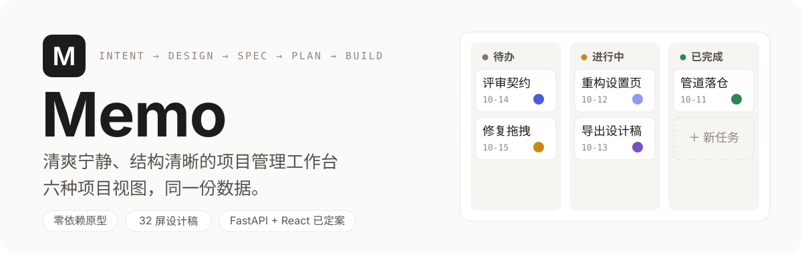
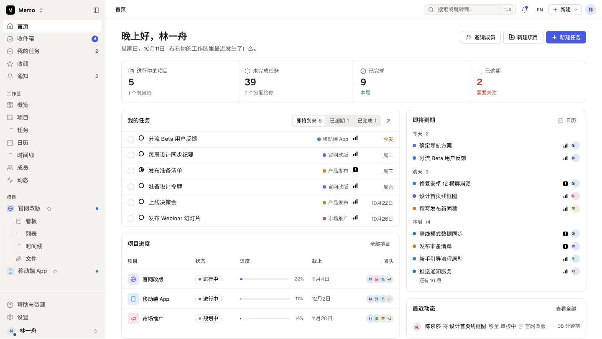
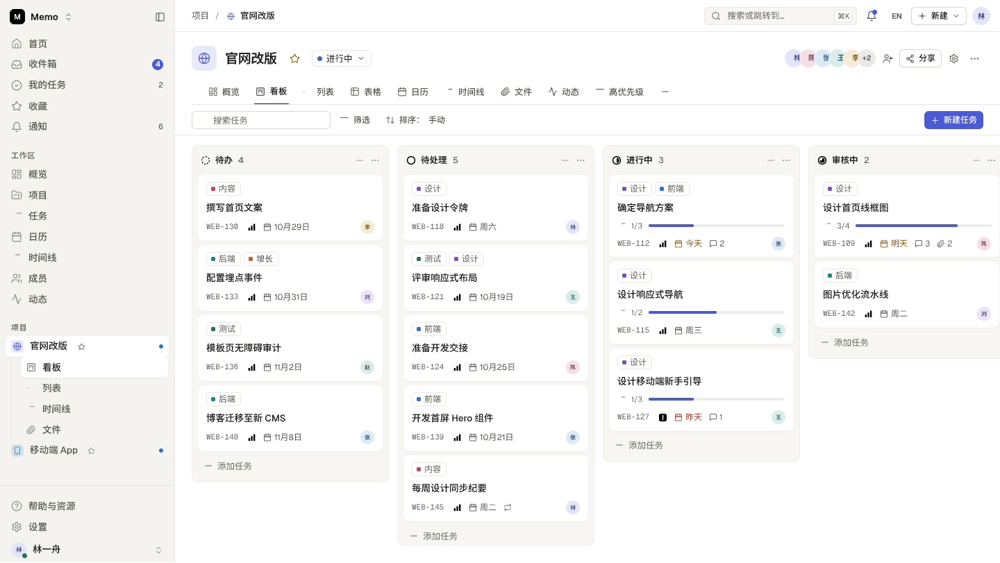
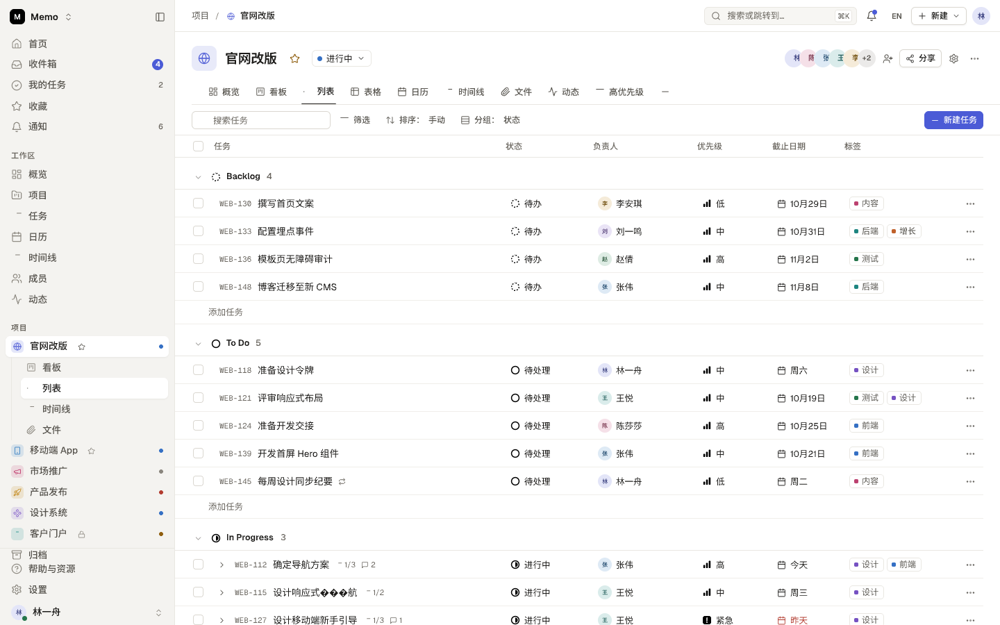
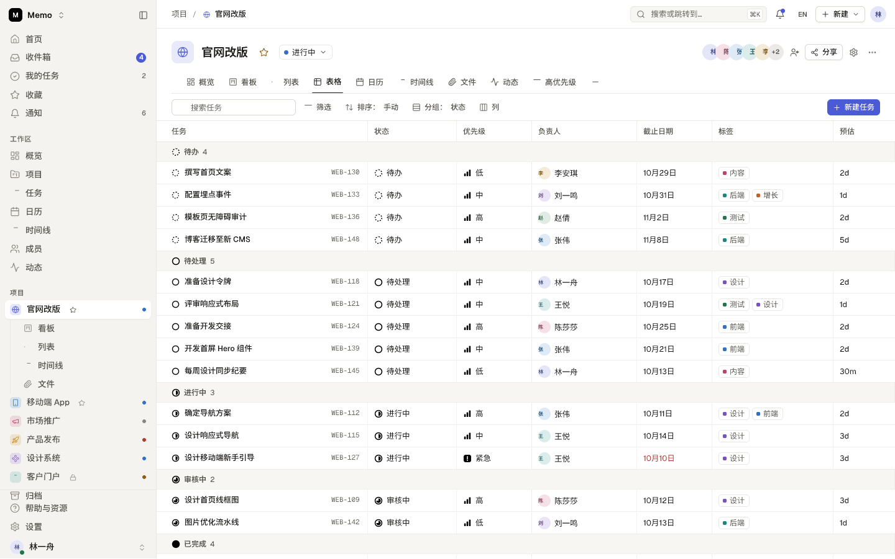
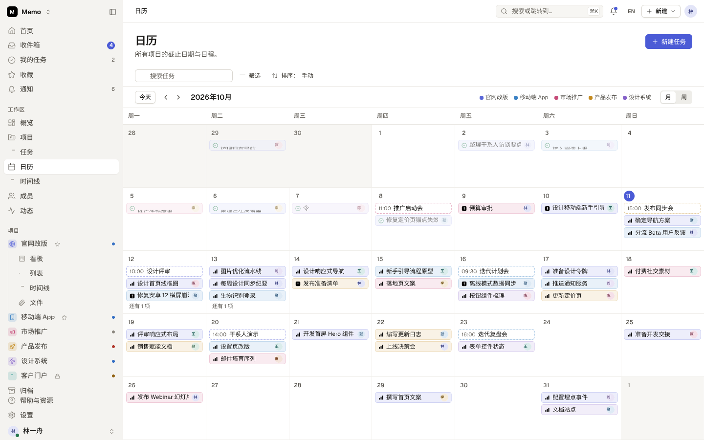
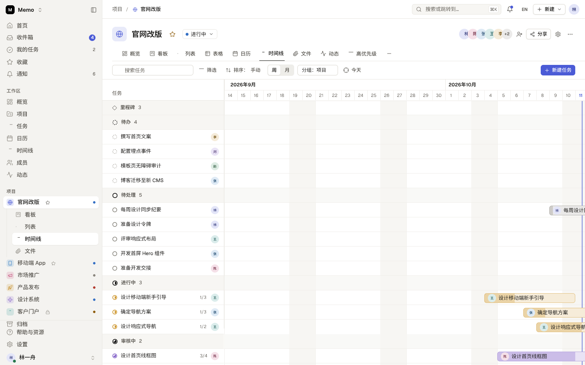
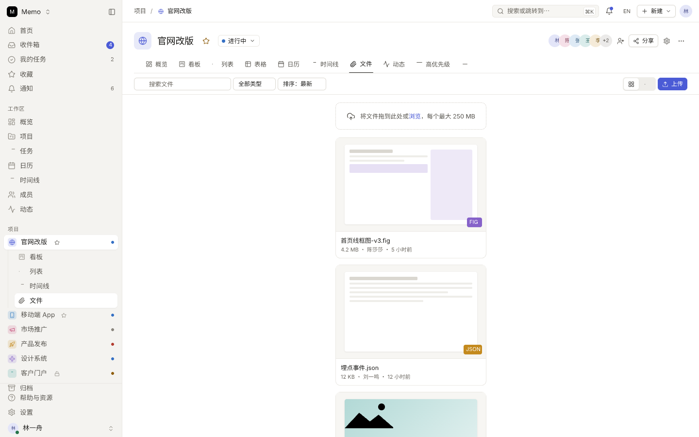
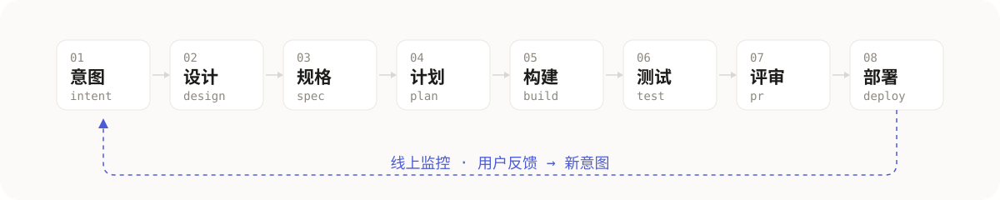
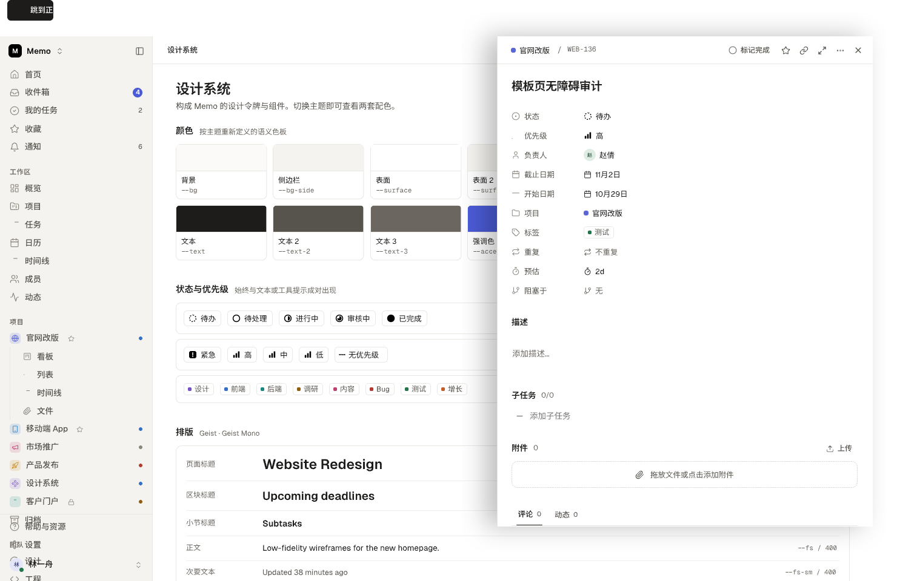

<p align="center">
  
</p>

**Memo** 是一个清爽宁静、结构清晰的项目管理工作台，面向个人开发者与小型团队。这个仓库里同时装着它的两样东西：一个**可交互的零依赖前端原型**与**全量入仓的设计稿**，以及一套把每次产品变更从想法一路推进到上线的**意图驱动工程体系**。

## 先看界面

首页仪表盘汇总今日待办与整体进展：

<p align="center">
  
</p>

项目内六种视图共享同一份数据，随取随切换：

<table>
  <tr>
    <td width="50%"><sub><b>看板</b> — 按状态分列，卡片拖拽改状态与顺序</sub></td>
    <td width="50%"><sub><b>列表</b> — 分组可折叠，多选与行拖拽排序</sub></td>
  </tr>
  <tr>
    <td><sub><b>表格</b> — 11 列，就地编辑与列配置持久化</sub></td>
    <td><sub><b>日历</b> — 月 / 周模式，拖拽调整到期日</sub></td>
  </tr>
  <tr>
    <td><sub><b>时间线</b> — 甘特条与依赖箭头，整体拖移</sub></td>
    <td><sub><b>文件</b> — 项目文件归集，过滤排序，可关联任务</sub></td>
  </tr>
</table>

以上均为设计稿的位图呈现，SVG 原件（32 屏：16 个页面模块、6 个项目视图与认证、命令面板等关键状态）版本化入仓于 [`intent/design/001/`](./intent/design/001/)，可评审、可 diff。

## Memo 是什么

一个把「安静」当功能做的项目管理工作台：

- **首页仪表盘** — Active / Open / Completed / Overdue 四卡口径，今日待办与项目进展一眼可读
- **收件箱与我的任务** — 通知与个人视角任务归集，未读分型、逾期分组
- **六种项目视图** — 看板 / 列表 / 表格 / 日历 / 时间线 / 文件，同一份数据自由切换
- **组织信息** — 成员、团队、动态与设置
- **双语界面，默认中文**；亮色为主、暗色重定义的主题体系
- 原型运行于浏览器 localStorage（键 `memo.v2`），内置演示种子数据，开箱即用

## 一个仓库，两条线索

本仓库同时是一个**意图驱动开发（intent-driven SDLC）**的工程实例：每个产品变更从一份人类可读、版本受控的意图文件出发，沿固定管道推进，闸门与规则全部落在仓库里，Agent 与人按同一套约定协作。

<p align="center">
  
</p>

- **意图** `intent/NNN-*.md` — 发起人写问题与期望，产品负责人批准
- **设计** — 设计稿与可交互原型迭代确认，导出物入仓（本仓库的 `prototype/` 与 `intent/design/001/` 正是这一阶段的产物）
- **规格** `NNN-spec.md` — 冻结契约，R# 需求编号的出生地，两遍走评审（先「是不是我要的」，再「能不能做、怎么证明」）
- **计划** `NNN-plan.md` — 机器可解析的变更文件清单与垂直切片批次，PR 以它做子集检查
- **构建 → 测试 → 评审 → 部署** — Agent 写码自证、确定性测试入 CI、多层评审对照计划

管道规则唯一源是 [`intent/README.md`](./intent/README.md)，Agent 协作约定见 [`AGENTS.md`](./AGENTS.md)。

## 快速开始

需要 Node.js 18+（`.nvmrc` 固定 22）。前端命令都在 `prototype/` 下执行：

```bash
cd prototype
npm install
npm run dev        # http://localhost:5173，热更新
```

| 命令 | 作用 |
| :--- | :--- |
| `npm run build` | 生产构建，产物在 `dist/` |
| `npm run preview` | 本地预览生产构建 |
| `npm run lint` | ESLint 检查 |
| `npm run format` / `format:check` | Prettier 格式化 / 校验 |

## 仓库结构

```text
memo/
├── AGENTS.md           # Agent 协作约定（活文档）
├── DESIGN.md           # 机器可读设计系统（design.md 规范）
├── prototype/          # 前端原型：原生 JS ES 模块 + CSS，零运行时依赖
│   ├── src/core/       # store（localStorage）、i18n、主题、常量
│   ├── src/shell/      # 布局、视图引擎、渲染、骨架屏
│   ├── src/pages/      # 路由页面
│   ├── src/views/      # 六种项目视图渲染器
│   ├── src/overlays/   # 任务抽屉、命令面板、模态框等弹层
│   └── src/data/seed.js# 演示种子数据
├── intent/             # 意图仓库：每条产品变更的意图 → 设计 → 规格 → 计划
│   └── design/001/     # 设计稿 SVG（32 屏，版本化入仓）
├── skills/             # 自建知识与 SOP
├── .agents/skills/     # 宿主技能池（第三方工程技能 + 自建技能）
├── docs/               # 参考资料与译文（只读）
└── assets/readme/      # README 视觉资产
```

## 设计系统

设计 token 的权威源是 [`prototype/src/styles/tokens.css`](./prototype/src/styles/tokens.css)（QUIRE 命名体系：亮色为主、暗色重定义而非反转）；机器可读版本同步在 [`DESIGN.md`](./DESIGN.md)，两者任一修改后运行 `npx @google/design.md lint DESIGN.md` 保持 0 警告。

<p align="center">
  
</p>

## 当前状态

产品按 [001 意图链](./intent/001-memo-workbench.md)推进（链仍 open）：

- [x] 意图接受 —— 「清爽宁静的项目管理工作台」
- [x] 可交互原型（`prototype/`，零依赖）
- [x] 全覆盖设计稿 32 屏入仓（`intent/design/001/`）
- [x] [规格冻结](./intent/001-spec.md)（R1–R18，含明确的负范围）
- [x] [实施计划批准](./intent/001-plan.md)（垂直切片分批，自 PR-1a 起）
- [ ] 生产实施：后端 FastAPI + PostgreSQL（单管理员账号、REST 快照 API、Docker compose 一键部署）；前端 Vite + React + TypeScript + Tailwind CSS + shadcn/ui
- [ ] 关链核验（按计划「证明」节逐项验收）

## 参与约定

- 产品变更从 [`intent/`](./intent/README.md) 出发：新想法先写意图文件，接受后再进入设计与实现
- 实施走 PR，变更文件以最近一次 accepted 的计划清单为比对基准（CI 做子集检查）
- 提交信息使用中文 Conventional Commits（`feat:` / `fix:` / `docs:` …）
- 提交前 `npm run lint` 与 `npm run format:check` 必须通过（在 `prototype/` 下）
- UI 文案经 `prototype/src/core/i18n.js` 与 `core/zh/` 管理，界面默认中文
