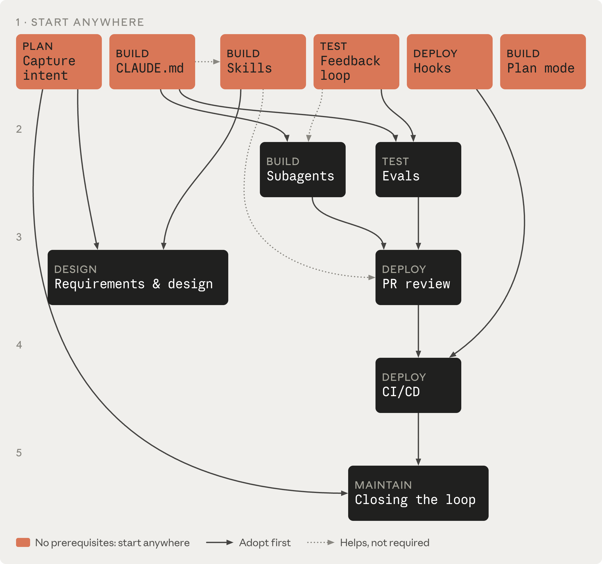

# 引言

> 课程：[The AI-native SDLC playbook](https://academy.claude.com/zh-CN/courses/ai-native-sdlc-playbook) · 阶段：引言 · 第 1 课 / 共 14 课
>
> 官方课程页：<https://academy.claude.com/zh-CN/courses/ai-native-sdlc-playbook/introduction>

---

各组织已经开始以一年前难以想象的速度用 AI 编写代码，但围绕代码的流程却没有以同样的速度改变。

软件开发生命周期（SDLC）是将软件从想法变为生产的过程。大多数组织都运行着同一套六个阶段的某种版本，涵盖规划（planning）、设计（design）、构建（building）、测试（testing）、部署（deploying）和维护（maintaining）软件。

## 转变

下表展示了传统 SDLC 与由 Claude 支持的 AI 原生 SDLC 之间的光谱两端。大多数组织介于两列之间。

| 阶段 | 传统 SDLC                      | AI 原生 SDLC                                                   |
| -- | ---------------------------- | ------------------------------------------------------------ |
| 规划 | 需求由委员会收集，通过工作坊和签字审批提炼，手工编写   | Claude 直接从源头综合痛点，并将其记录在人类可读、机器可执行的 `intent.md` 中             |
| 设计 | 规格由分析师编写，由设计师解析              | 需求与设计压缩为与智能体的一次工作会话，由编码为技能包（skill）的标准引导，在 Git 中做版本管理         |
| 构建 | 测试和代码由手工编写，文档在主开发完成之后才编写     | 测试和代码由 AI 生成，机构知识以版本化、机器可读的 `CLAUDE.md` 文件和技能包的形式维护          |
| 测试 | 阶段边界的 QA 关卡                  | 持续评估（continuous evals）贯穿实现过程                                 |
| 部署 | 人类逐行评审代码，治理发生在评审周期中，且往往执行不一致 | 多层智能体评审，人类评审保留给受监管和关键代码。治理在 AI 行动的同时强制执行，以钩子（hooks）作为审批关卡    |
| 维护 | 人类盯着生产环境找 bug                | 智能体监控线上部署。任何被突破的控制带（control band）都会被诊断并作为新的 `intent.md` 写回循环 |

对于每一项需要判断力的决策，人类仍然负有最终责任。

## 手册里的策略如何运作

策略（plays）是手册的核心，按六个非线性阶段（规划、设计、构建、测试、部署、维护）分组，共同覆盖完整的生命周期。

每项策略涵盖：

- 有何变化
- 开始之前
- 具体的实施步骤
- 治理考量
- 如何衡量它是否奏效

每项策略在「前置条件」下列出它的依赖，下面的依赖关系图对此做了进一步说明。

*策略依赖关系图。第一行的策略没有前置条件；实线箭头指向建立在它之上的策略，虚线箭头表示有帮助但不是必需的。*

## 选择你的第一个策略

这些策略是模块化的，组织可以根据自身需求，在不同时间优先改造不同阶段。

上图第一行的六项策略没有前置条件：

- **规划**：以 intent.md 捕获意图
- **构建**：将 Claude Code 计划模式作为默认起点
- **构建**：CLAUDE.md
- **构建**：将技能包作为机构知识
- **测试**：给 Claude 一个反馈回路
- **部署**：以钩子作为审批关卡
