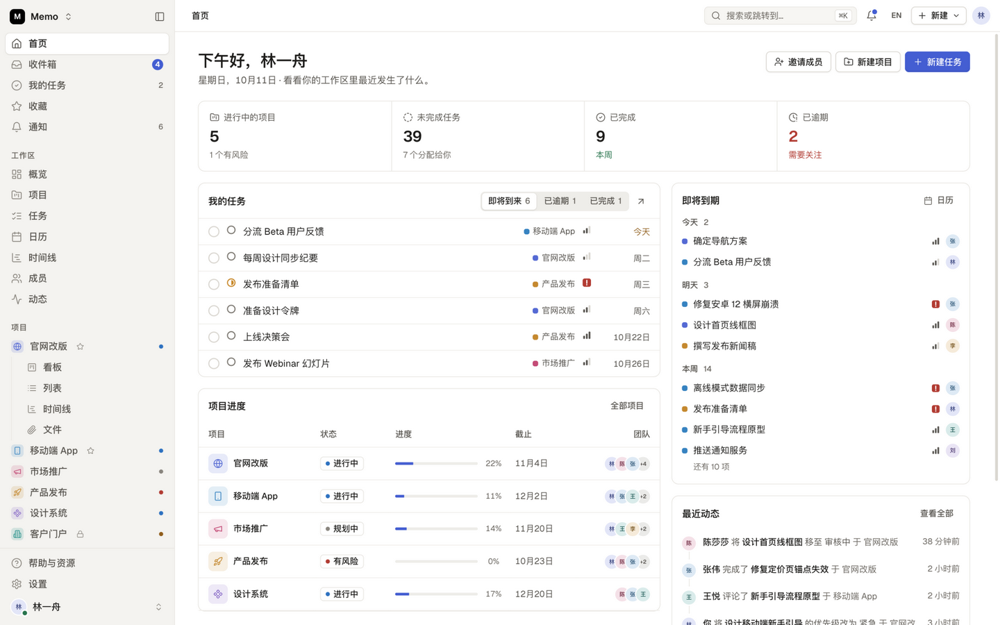

# Memo

一个清爽宁静、结构清晰的项目管理工作台：首页仪表盘、收件箱、我的任务、项目（支持看板 / 列表 / 表格 / 日历 / 时间线 / 文件视图）、成员、团队、动态与设置。

基于原生 JavaScript ES 模块和 CSS 构建，由 [Vite](https://vite.dev) 打包。没有使用任何 UI 框架，也没有运行时依赖。



## 快速开始

需要 Node.js 18 或更高版本（`.nvmrc` 固定为 22）。

```
npm install
npm run dev       # http://localhost:5173，支持热更新
npm run build     # 在 dist/ 目录生成生产环境构建
npm run preview   # 本地预览生产构建
npm run lint      # ESLint 代码检查
npm run format    # Prettier 代码格式化
```

## 项目结构

```
index.html              HTML 入口，加载 src/main.js
public/favicon.svg      品牌图标
vite.config.js          Vite 配置，包含 Lucide 图标子集插件
eslint.config.js        代码检查规则（ESLint flat config）；格式化由 Prettier 负责（.prettierrc.json）
.github/workflows/      CI：代码检查、格式检查、构建
docs/preview.png        README 截图
src/
  main.js               入口：引入样式和各模块，然后启动应用
  styles/
    index.css           按层叠顺序引入所有样式表
    tokens.css          颜色、间距、字体、圆角，以及共享的 --gutter
    base.css  components.css  shell.css  panels.css  overlays.css  states.css  motion.css  responsive.css
    views/              列表、看板、表格、日历、时间线、项目与文件视图
    pages/              设置、登录与新手引导页
  core/                 工具函数、常量、图标、store（状态 + 查找表）、主题
  data/seed.js          演示工作区数据
  ui/                   共享渲染辅助函数、toast 提示、下拉选择组件
  shell/                渲染循环与路由、侧边栏/顶栏布局、骨架屏、视图引擎
  components/           任务列表渲染器
  pages/                每个路由对应一个模块
  views/                项目视图：看板、表格、日历、时间线、文件、概览
  overlays/             任务抽屉、模态框、气泡弹层、右键菜单、命令面板
  features/             团队、子任务、归档（渲染）
  actions/              用户操作、事件绑定、键盘快捷键、拖拽
```

### 分层规则

依赖方向自上而下：

1. `core/` 和 `data/` 不依赖应用中的任何其他部分。

2. `ui/`、`shell/`、`components/`、`pages/`、`views/`、`overlays/` 和 `features/` 根据状态渲染 HTML。

3. `actions/` 负责修改状态并触发重新渲染。每个 action 模块在加载时会把处理函数注册到共享的

   action 表（`A`）上，因此 `main.js` 会在 `actions/actions.js` 之后引入它们。

## 编码约定

- **渲染：** 每个页面或视图都是一个函数，从 store（`S`）生成并返回 HTML 字符串。

  `render()` 会重建外壳（shell），并保持焦点和滚动位置。

- **交互：** 元素通过 `data-a="actionName"` 声明行为。`actions/events.js` 会把点击事件

  委托给对应的 `A.actionName`。输入框使用 `data-in`，失焦处理使用 `data-blur`。

- **布局：** 所有页面边缘统一使用 `var(--gutter)`，保证面包屑、页头、工具栏、列表、

  表格和看板从同一条竖线开始对齐。

- **下拉框：** 直接写普通的 `<select class="select">`。`ui/select.js` 会把它渲染成

  设计系统样式的菜单，同时保持原生元素作为唯一数据源。

- **图标：** 调用 `ic('name')` 并传入任意 [Lucide](https://lucide.dev) 图标名。

  `virtual:icons` 插件只打包源码中实际用到的图标。

## 持续集成

每次推送和 pull request 都会运行代码检查、格式检查和生产构建

（`.github/workflows/ci.yml`）。
